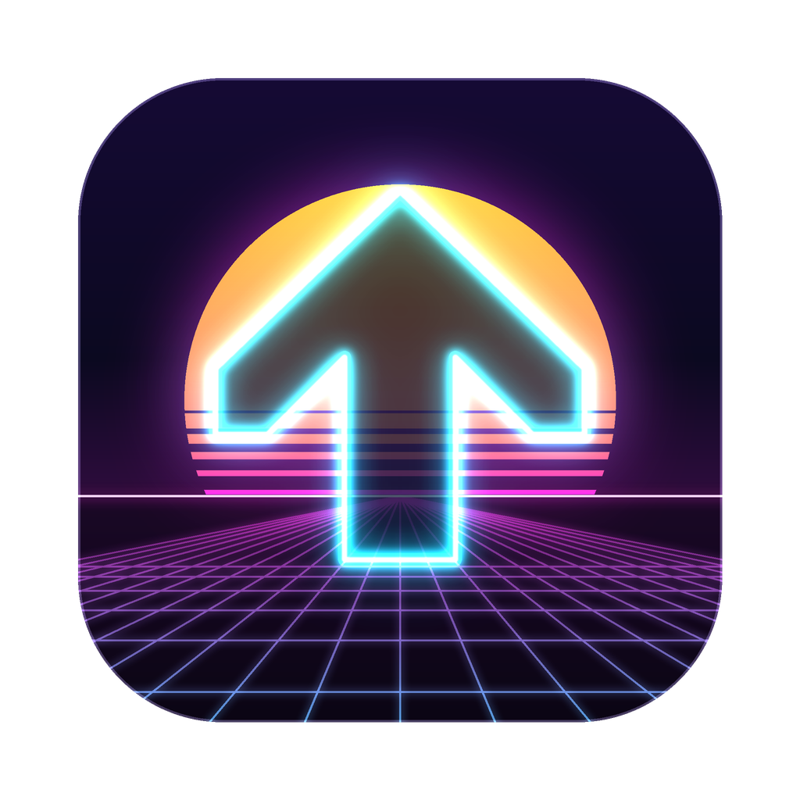
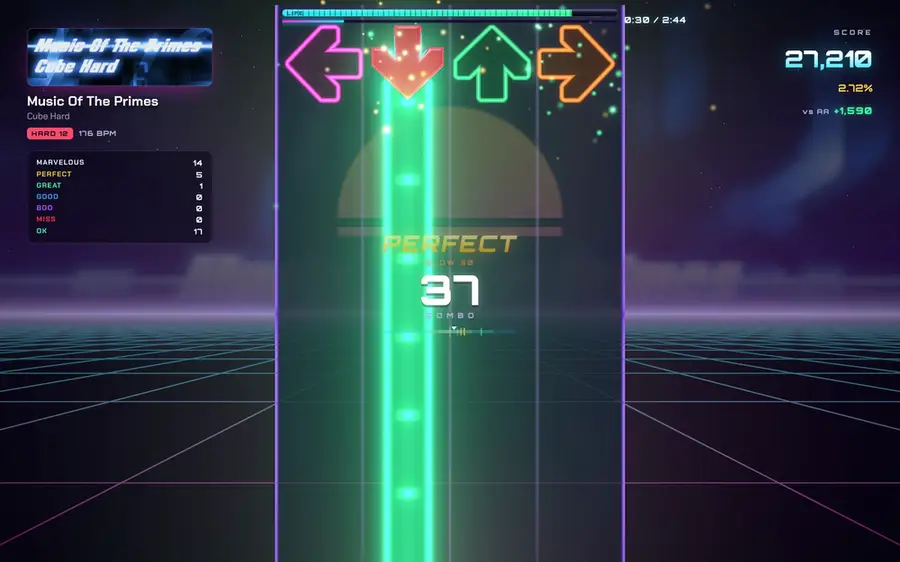
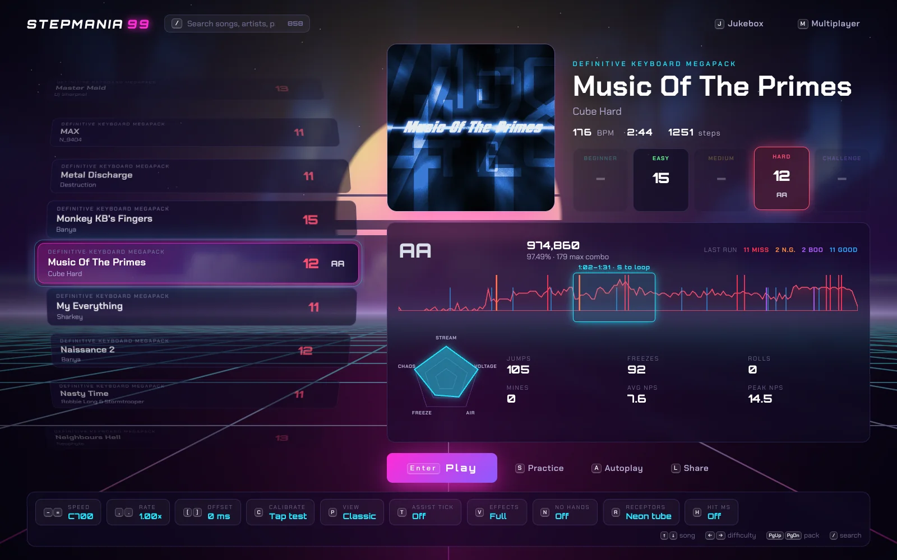
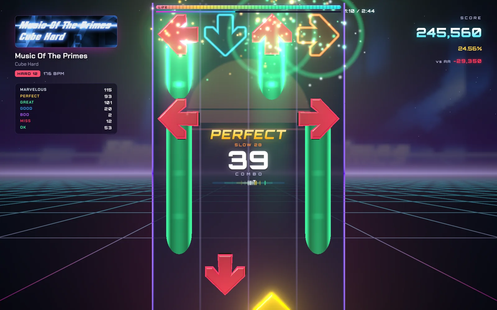
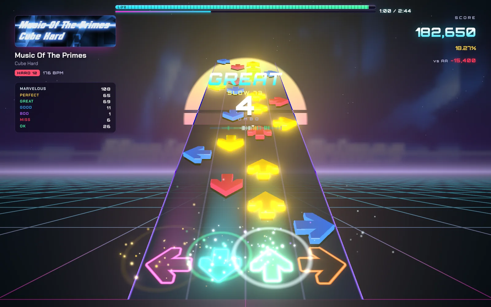
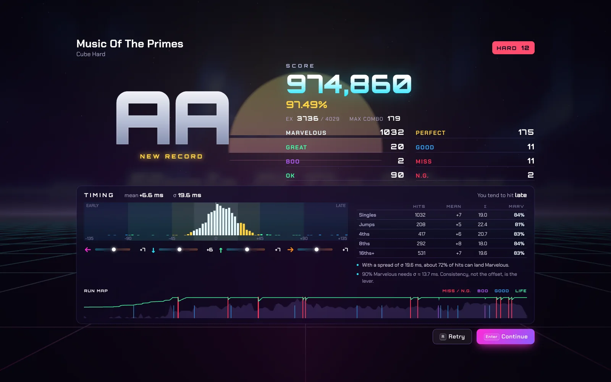
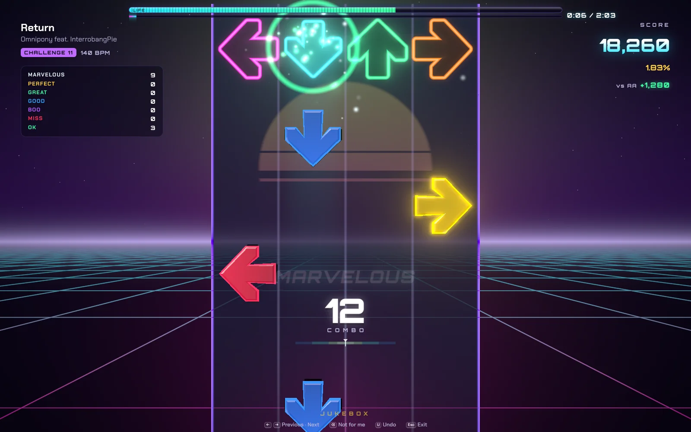

<p align="center"></p>

<h1 align="center">StepMania 99</h1>

<p align="center">
  A StepMania-style rhythm game that plays <b>your own song packs</b>, judges every arrow to the millisecond,<br>
  and throws you into a battle royale with up to 8 players.
</p>

<p align="center">
  <a href="https://sderosiaux.github.io/stepmania99/"><b>Play in the browser</b></a> ·
  <a href="#desktop-app">Mac app</a> ·
  <a href="#controls">Controls</a> ·
  <a href="docs/decisions.md">How the timing works</a>
</p>

<p align="center"></p>

Every screenshot here comes from the game itself, on a real chart (*Music Of The Primes*, Hard 12), played by a bot that sends real key events with a human amount of error.

## Your songs



Point it at a StepMania or OutFox `Songs` folder and every pack shows up: 945 songs in 18 packs here. The desktop app rescans the folder in about 120 ms once it has a cache. `.sm` and `.ssc` files are read with the game's own parser, so a song in the list is a song you can play.

On the density graph, red and blue ticks mark where your last run broke (misses, N.G. freezes, boos, goods). Drag across the graph to pick a section, press `S`, and it loops that stretch until you have it. The groove radar and the stats beside it tell you what kind of chart you're about to face before the music starts.

## Judged on the key press, not the frame



Each key press is judged at the timestamp the browser gives the event, mapped onto the audio clock **as heard**, after the output latency. The frame rate never touches a judgment. Windows are StepMania's J4: 22.5 / 45 / 90 / 135 / 180 ms, with DDR-style freezes, rolls that need re-tapping, and mines.

The meter under the life bar shows how far into the song you are. The pacemaker on the right compares you, point for point, with your personal best (or an AA if you have none yet). The receptors glow like the freeze bodies, in two styles (Neon tube, Hologram).

## Classic or highway



`P` tilts the playfield into a highway that recedes toward the sun. `V` switches to Focus: no bloom, no particles, only arrows.

## Results



The grade is the least interesting part. You get the timing spread, your early/late tendency per arrow direction, your accuracy on singles, jumps, 4ths, 8ths and 16ths, and a run map showing where the life bar dipped. If your hits lean one way consistently, the screen offers to fix your offset.

## Battle royale

Up to 8 players in a room. Every 15 combo sends an arrow to a rival, and theirs show up on your field flashing red and white. Last one standing wins; if several make it to the end, the highest score does. Rooms are joined by code or by link.

## Jukebox



`J` shuffles the songs you're looking at and lets the game play them on its own. `←` `→` to go back and forth, `⌫` to drop a song you never want to hear again (it remembers), `U` to undo.

## Controls

| Where | Keys |
|---|---|
| Playing | Arrows or `S` `D` `K` `L`. USB dance pads and gamepads work too. |
| In a song | `Esc` pause, then `Enter` resume after a 3-2-1 or `R` restart from the top · `V` effects on/off |
| Song select | `↑` `↓` song · `←` `→` difficulty · `PgUp` `PgDn` pack (level when grouped by level) · `G` group by pack or level · `/` search, `lv:12`, `lv:10-12` or `lv:12+` for levels · `Enter` play · `A` autoplay · `S` practice |
| Options | `O` options panel · `-` `=` speed · `,` `.` rate · `[` `]` offset · `C` calibrate · `P` view · `T` assist clap · `N` no hands · `R` receptors · `H` hit ms |
| Elsewhere | `J` jukebox · `M` multiplayer · `L` copy a link to this chart · hold `Tab` to fast-forward the menus |

**Calibrate before anything else.** `C` plays a clap; tap along with your eyes closed. It measures your offset from the audio alone, since a visual cue would add display lag to the number. On Bluetooth headphones expect 100 ms or more, and calibrate again when you switch outputs.

No hands (`N`) turns 3- and 4-arrow rows into jumps. Those runs don't count as records.

## Run it

### In the browser

```bash
npm install
ln -s "/Applications/OutFox/Songs/Some Pack" public/songs/   # any StepMania pack folder
npm run dev                                                   # http://localhost:3000/stepmania99/
```

`npm run dev` rescans `public/songs` on every start. The [online build](https://sderosiaux.github.io/stepmania99/) ships with one song and a few drills. Packs: [StepMania Online](https://stepmaniaonline.net/), [Zenius-I-vanisher](https://zenius-i-vanisher.com/).

### Desktop app

```bash
npm run app:dist     # builds release/mac-arm64/StepMania 99.app
```

The Mac app reads `/Applications/OutFox/Songs` directly; list other folders in `~/Library/Application Support/StepMania 99/library.json`. It runs offline, keeps playing when the window is hidden (handy for the jukebox), and starts the audio without waiting for a key press. `npm run app` runs it from source.

### Multiplayer and tests

```bash
npm run dev:all      # game + multiplayer server on ws://localhost:3001
npm test
```

Sound effects and announcer lines live in `public/sfx/`. Regenerating them needs an ElevenLabs key: `ELEVENLABS_API_KEY=... node scripts/generate-sfx.mjs`.

Why the clock, the judge and the renderer are built the way they are: [docs/decisions.md](docs/decisions.md).

## License

MIT
